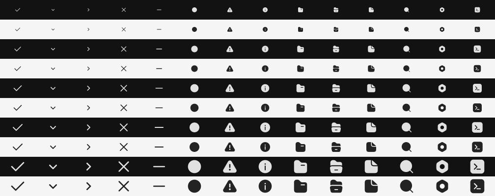

# Built-in icon assets

Alicorn's 14 `Icon_ID` identities use Reicon's **filled** artwork, pinned to
`580d777a3c8d3dbcb66115eb2ef5dfab550e68b6`. `assets/icons/reicon/sources.json`
records the upstream category/name, source-data and SVG hashes, and license.
The vendored SVGs and complete MIT license are checked in. Application package
tools copy the Reicon notice into Windows packages and macOS app resources.

## Generation

`tools/generate_icon_atlas.py` uses pinned **resvg 0.48.1** as an offline tool.
It accepts a restricted opaque monochrome SVG subset, rejects external
resources, renders white on transparency without system fonts, and extracts
the PNG **alpha** channel. It creates a distinct coverage mask for every
integer physical size from 8 through 64 pixels, inclusive.

```powershell
cargo install resvg --version 0.48.1 --locked --root .deps/icon-tools
python tools/generate_icon_atlas.py --resvg .deps/icon-tools/bin/resvg.exe
python tools/generate_icon_atlas.py --resvg .deps/icon-tools/bin/resvg.exe --verify
python tools/test_icon_assets.py
```

Normal Odin builds read checked-in masks and metadata. They do not need
Python, Cargo, resvg, source SVG files at runtime, or any additional DLL.
`--verify` regenerates the atlas, manifest, Odin lookup table and contact sheet
and compares every output byte without modifying committed outputs. CI runs
this check. Source restoration, if needed, is separate:
`python tools/fetch_reicon_icons.py`; it downloads only the pinned revision and
verifies source-data, artwork and license hashes before using them.

The deterministic descending-size shelf packer uses 1024-pixel-wide pages and
two transparent pixels around each icon. The current two R8 pages total
**1,572,864 bytes**. Row pitches are multiples of 256 bytes and staging offsets
are multiples of 512 bytes. The generated manifest records packing version,
dimensions, provenance and page SHA-256 checksums.

The contact sheet's columns follow `Icon_ID`: Check, Chevron Down, Chevron
Right, Close, Minus, Radio Selected, Warning, Info, Folder Closed, Folder Open,
File, Search, Settings, Terminal. Rows show 12, 16, 20, 24 and 32 physical
pixels, each against dark and light surfaces.



## Runtime contract

`icon(...)`, `icon_button(...)`, control semantics and hit rectangles retain
their existing API. `Icon_Paint` carries identity, tint and normal retained
paint geometry. Artwork weight is fixed by the selected generated asset.

The native `Native_Icon_Renderer` owns its pipeline, sampler, textures and mesh
storage independently of Runa's text atlas. Its lifetime is aggregated into
the host's compositor resources through `Native_Solid_Renderer.icons`.
Initialization validates embedded metadata and uploads all R8 pages in one
staging submission. Partial initialization releases all resources. Renderer
or device recreation reloads the same embedded data.

Rendering uses finalized absolute pixel edges through the existing
`logical_to_pixel_bounds` conversion. Size selection precedes clipping;
clipping changes quad bounds and UVs, not the mask selection or layout.
Samples use linear filtering, no mipmaps, and UVs at texel boundaries so
physical pixel centers sample texel centers. Transparent gutters isolate
neighbors. Outside 8–64 pixels, the nearest endpoint mask is resampled.

Each icon uses six vertices. Adjacent icons can share an ordered compositor
run, but never cross surfaces, text or custom geometry. An icon mesh
fingerprint includes identity, final geometry, clipping, translation, tint,
opacity, DPI, command positions and target dimensions. Static frames reuse
the mesh; color and DPI changes update the mesh without changing textures.
No icon timers, SVG parsing or rasterization run during interaction or idle.
Diagnostics expose icon atlas uploads, upload bytes, mesh rebuild/cache hits
and vertex uploads.

Fragment RGB is straight theme tint; fragment alpha is mask coverage × tint
alpha × command opacity. RGB factors are `SRC_ALPHA / ONE_MINUS_SRC_ALPHA`;
alpha factors are `ONE / ONE_MINUS_SRC_ALPHA`. A transparent target therefore
stores the usual accumulated source-over alpha and associated RGB. Existing
solid/text pipeline blend behavior is unchanged.

DXIL and SPIR-V fragments are checked-in offline artifacts generated with
DXC **v1.9.2609** and glslang **16.6.0**. Equivalent Metal source is compiled by
SDL on the Metal device. Shader sources and tool versions are retained;
`tools/build_icon_shaders.ps1 -Verify` checks regenerated binary artifacts.

## Native validation

Windows:

```powershell
.\tools\validate_icons.ps1 -Odin 'C:\Users\saman\Documents\odin\dist\odin.exe'
.\tools\widget_gallery.ps1 -Odin 'C:\Users\saman\Documents\odin\dist\odin.exe'
```

The offscreen GPU proof reads back real RGBA pixels at 100%, 125%, 150% and
200% scale, checks single and overlapping translucent icon coverage, verifies
static mesh reuse and zero additional atlas uploads, and recreates the device.
Windows D3D12 is validated locally. macOS Metal validation remains manual.

On macOS, after the normal Alicorn toolchain and dependencies are available:

```sh
sh ./tools/validate_icons.sh --odin /path/to/odin
./tools/widget_gallery.sh --odin /path/to/odin
```

The validation command must report `driver metal`, `atlas_uploads 2`, and
`transparent_source_over true` twice. In the gallery, inspect Checkboxes and
Select + Notices; open Select, stack/dismiss notices, and inspect the filled
folder and Search icons. Check standard and Retina scale, a different display
if available, and disabled indicators. The gallery's `--icon-fixture` option
opens Select + Notices with a persistent warning for repeatable captures.
