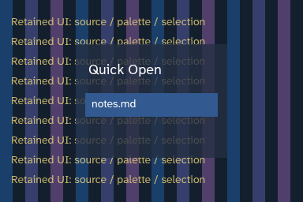

# Issue #111: bounded retained backdrop blur

Research: 2026-11-03; Gaussian quality validation: 2026-11-04; host retry and API promotion: 2026-11-04.
Sources: [primary-source review](../research/retained-effects-issue-111.md).

## Scope and decision

Backdrop blur is now a supported, bounded semantic-surface capability in Alicorn's native SDL_GPU window compositor. Applications request it with `backdrop_blur(sigma, .Direct)` on `surface_begin`; Alicorn owns capture, Gaussian filtering, retained textures, fence tracking, composition, and fallback. This is a focused material capability, not a general effects graph. Existing analytic materials remain the component-shadow implementation.

Scratchpad Quick Open is the first ordinary consumer. It uses a stable six-logical-pixel Gaussian, 70% panel fill, and 50% modal dim. The developer comparison/tuning controls and compile-time feature gate have been removed. The user confirmed that the Gaussian result is visually useful, then found that interaction-triggered cache deferral could leave one direct fallback frame displayed until another pointer event. The host now distinguishes temporary fence deferral from permanent fallback and schedules a host-only retry; cached idle scenes still arm no timer or wake.

The bounded host implementation has hosted readback validation on both Metal and D3D12. The macOS and Windows foundation jobs passed on PR head `6a5a104`; see the [Metal workflow](https://github.com/samanshaiza004/alicorn/actions/runs/42293184017) and [D3D12 workflow](https://github.com/samanshaiza004/alicorn/actions/runs/42293184107). These results validate the bounded readback fixture on those backends, not interactive frame pacing or universal renderer parity. The newly integrated head still needs fresh CI. The local validation environment has no enumerated macOS display, so it cannot complete the live GUI path.

The Gaussian quality gate replaced the stretched five-tap binomial with a sampled discrete Gaussian. Metal readbacks compare against an independent dense CPU convolution. The filter is correct for the documented encoded-SDR contract; linear-light treatment, HDR, wide-gamut color management, and output corner masks are outside this version.

## Run

```sh
sh tools/validate_effects.sh --odin /path/to/odin
# Where SDL supports Vulkan:
sh tools/validate_effects.sh --odin /path/to/odin --driver=vulkan
```

```powershell
./tools/validate_effects.ps1 -Odin odin
./tools/validate_effects.ps1 -Odin odin -Driver vulkan
```

The runners execute native unit tests, then device-only GPU readbacks. Requested-device failure is a failure, never a silent pass or a switch to a different renderer. Captures are written to `out/retained-effects/{flat,analytic-shadow,blur-cold,blur-retained}.ppm`. Foundation CI runs Metal and D3D12 readbacks; the linked workflow results above passed on PR head `6a5a104`.

## Boundary and rendering contract

The validation fixture's `Native_Effect_Request` contains one stable key,
authoritative source generation, resolved output rectangle/ancestor clip,
uniform DPI scale, Gaussian standard deviation (`sigma`) in logical pixels,
and depth. The fixture advances the source generation explicitly. In the
application path, a paint-stream marker defines the boundary and the
host hashes the commands before it together with bounds, clip, DPI scale, and
effect parameters. Commands after the marker (including Quick Open
query/results) do not invalidate the backdrop. This observes only the generic
paint commands represented in that prefix; it is not a general dependency
tracker for arbitrary GPU resources.

The effect captures the specified paint prefix before foreground commands. It
replays it through `draw_display_list`, translated into the input rectangle,
with the original per-command clips preserved. It never samples a swapchain.
The palette comparison replays a **known opaque background** with the prefix;
the filtered alpha-one result replaces the original backdrop at composition.
Replaying a transparent prefix over itself would double-composite it and is
not a valid general backdrop capture. Transparent isolated layers are tested
separately by the readback cases.
The input includes the complete three-sigma halo on each side and rounds
outward in physical pixels. The output is scissored to the resolved
region/ancestor intersection. Nested effects are rejected; nested ordinary
clips are retained.

The filter is a separable, discrete Gaussian truncated at
`ceil(3 * sigma_physical_pixels)`. It computes normalized dense weights, then
pairs adjacent weights on each side into fractional-offset samples. Linear
texture filtering reconstructs the paired integer coefficients, reducing the
number of shader draws without stretching a sparse fixed-tap kernel across a
wider radius. The tap count grows with sigma and is bounded at 97 samples per
axis. The same compiled image shader handles every tap; no new shader artifact,
runtime compilation, or backend-specific effect implementation is needed.
Capture uses RGBA8_UNORM; horizontal and vertical intermediates use
RGBA16_FLOAT to avoid quantizing each weighted contribution to eight bits.
Two filter passes accumulate premultiplied RGBA; composition uses
`ONE, ONE_MINUS_SRC_ALPHA` so alpha is not multiplied twice. The final palette
and foreground retain painter order. All passes end before the next pass
begins.

The color contract is **encoded SDR RGBA8**, matching the existing ordinary
UNORM renderer. This is deliberately not a linear-light blur. HDR, sRGB render
targets, wide-gamut/native display color management, and rounded effect-output
masks are unimplemented. This supported API currently excludes those cases; changing the whole renderer's
color contract is outside this feature slice.

## Bounded retention and failure behavior

- The low-level fixture uses one slot. The primary application host uses
  two fence-tracked slots, each with three textures, maximum 2048 physical
  pixels on either axis, sigma at most eight logical pixels (32 physical
  pixels), radius at most 96 physical pixels, and depth one. The app cache has
  a 48 MiB requested-storage budget across slots. There is no unbounded cache
  or hidden full-window target.
- The fixture uses a 16 MiB budget for requested texture and fixed vertex/transfer
  buffer bytes. Existing source-renderer buffers, final target/readback buffers,
  pipeline/sampler objects, and driver allocation overhead are excluded. This
  is not a measurement of total frame memory or hardware texture residency.
- Textures and buffers do not cycle. A changed source generation repaints the
  complete bounded input; unchanged generations reuse the filtered result.
  There is no partial-damage algorithm.
- The isolated validation fixture uses conservative device-idle retirement.
  The application path reuses a slot only after its last-use submission fence
  retires; if both slots are busy, the host draws directly for that frame and
  schedules one retry opportunity. At that opportunity it waits only through
  the earliest fence that can free a cache slot, rather than polling the GPU
  continuously. A hard budget/format/allocation failure remains a direct
  fallback. Ordinary replacement, resize, and dismissal do not drain the GPU. Device-idle
  waiting remains a shutdown fallback after the host's final submission wait.
- Unsupported format, budget, or allocation failure chooses direct drawing.
  Canceled/submission-failed work is not published as a valid output generation.
  Reset retires the slot; a fresh cache recreates resources lazily.
- Device loss is not transparently recovered. A failed device requires the
  host's device teardown/recreation; old cache handles must never migrate to a
  new device. Actual device removal and injected submit failure remain untested.
- Initially inactive scenes create zero effect resources. A stable cached scene
  performs no filter pass, allocation, submission, timer, or wake. A retry timer
  exists only while a valid effect is deferred by in-flight GPU work; the host
  consumes it once, retires the relevant submission fence, and redraws without
  rebuilding or acknowledging the application description.

## Validation and measurement boundaries

The CPU reference directly convolves the generic renderer's downloaded source
pixels with every normalized dense Gaussian coefficient, then computes
premultiplied source-over and foreground ordering. This is independent of the
GPU's bilinear-paired taps and half-float intermediates, and validates the
filter and composition; the source renderer's correctness remains covered
separately by the existing blend/readback suite. Source and destination never
alias. A frequency-response regression also checks that the new Gaussian
attenuates a six-pixel repeating pattern that the former spacing-six binomial
filter passed unchanged.

Readbacks cover transparent colored edges, text, ancestor clipping, input halo,
foreground overlap, sigma values 1/4/8 at scales 1/1.5/2, source-generation
changes, cache reuse, fresh rebuild equality, cancellation, reset/recreation,
and direct fallback. The maximum supported physical sigma is also checked at
the unit-test boundary (97 bounded paired samples per axis).
Transfer rows are padded to the D3D12-compatible 256-byte alignment. The unit
tests reject invalid numeric values, oversized regions, excess nesting, and
missing source identity before allocation.

The fixture is built with `-o:speed`. Timing prints first-frame encoding and
submission-to-fence wall time, followed by
40 warm samples' p95 for flat, direct analytic shadow, changed-source blur,
and retained blur during a forced ordinary repaint. The first sample's artifact
readback is excluded from warm samples. These first frames occur in a warmed
process after correctness probes; they are not cold application/driver startup
measurements. Encoding wall time includes preparation and the conservative
device-idle wait. Submission-to-fence wall time includes
driver/queue/wait costs and is **not hardware GPU timestamp duration**. SDL_GPU
does not expose a portable timestamp query used by this fixture. Captures,
correctness readbacks, and device-idle resize stalls are not described as frame
presentation latency.

Remaining validation includes stationary-pointer interaction after a deferred
rebuild, Windows/D3D12 native UI behavior, hardware GPU time and residency
measurements, native idle tracing with an enabled but cached effect, failure
injection/device removal, and resize/close stress under two frames in flight.

## Scratchpad Quick Open integration

Quick Open now uses the supported Alicorn surface API directly:

- Gaussian sigma: 6 logical pixels.
- Panel fill: 70% opacity, keeping query/results foreground readable.
- Workspace dim: 50% opacity.
- The bounded result list and all foreground text remain crisp.
- The panel keeps a fixed ten-row viewport, so query and result changes do not alter the capture bounds.

The blur marker precedes the panel fill and its children. Typing and result navigation change foreground paint only and should reuse the same captured prefix. Edits, scrolling, theme, geometry, clipping, and scale changes behind Quick Open invalidate the cached image. A host that cannot satisfy the bounded resource policy draws the direct panel fallback.

The user has visually reviewed the Gaussian treatment and reported the interaction-triggered disappearance now addressed by the deferred-effect retry. The user should recheck stationary-pointer behavior after the updated Alicorn and Scratchpad revisions are built on their interactive Mac. This environment cannot enumerate a display, so I could not independently reproduce the GUI interaction here.

## Historical native results: five-tap prototype

These measurements are retained to document the original prototype. Its
fixed-spaced binomial filter was visually inadequate at wide spacing and these
numbers do not describe the Gaussian implementation below.

Apple M1 MacBook Air, 8 GiB, macOS 27.2; Odin
`dev-2026-11-nightly:9a69916`, SDL 3.4.18. One run, 40 warm samples per mode,
384×256 final target. The resolved output is 192×144 at 1×; padded input is
208×160. Metal API validation enabled.

| Mode | First encode / submit-wait (ms) | Warm encode p95 (ms) | Warm submit-wait p95 (ms) | Warm render passes | Effect bytes live/peak |
| --- | --- | --- | --- | --- | --- |
| Flat palette | 2.562 / 1.650 | 1.514 | 2.154 | 15 | 0 |
| Existing analytic shadow | 1.546 / 1.273 | 1.626 | 2.656 | 16 | 0 |
| Blur, source changed every frame | 3.804 / 2.204 | 2.880 | 4.107 | 29 | 404,112 |
| Retained blur, forced ordinary repaint | 3.210 / 2.101 | 1.586 | 2.259 | 16 | 404,112 |

This earlier filter used five taps per axis and RGBA8 intermediate targets.
Its source-changing mode replayed and filtered every frame; retained mode
filtered once then reused the result. See [the original raw run](raw/issue-111-metal-2026-11-04.txt).

## Gaussian native results: Apple M1, macOS 27.2, Metal

Odin `dev-2026-11-nightly:9a69916`, SDL 3.4.18; baseline commit `fe8967f` plus
the retained-effects branch merged with `origin/master` `067ff0c`, plus this
Gaussian implementation. Metal API validation was enabled. One run, 40 warm
samples per mode, 384×256 final target. The effect's resolved output is
192×144 at 1×; at sigma 4 its padded input is 216×168. These are small fixture
results, not a product benchmark or a cross-framework comparison.

| Mode | First encode / submit-wait (ms) | Warm encode p95 (ms) | Warm submit-wait p95 (ms) | Warm render passes | Effect bytes live/peak |
| --- | --- | --- | --- | --- | --- |
| Flat palette | 2.807 / 5.493 | 1.564 | 4.756 | 15 | 0 |
| Existing analytic shadow | 1.618 / 1.428 | 1.634 | 4.731 | 16 | 0 |
| Blur, source changed every frame | 4.055 / 2.141 | 2.986 | 7.997 | 29 | 810,000 |
| Retained blur, forced ordinary repaint | 3.503 / 1.822 | 1.673 | 7.810 | 16 | 810,000 |

The Gaussian source-changing mode replayed the prefix and filtered each time
(82 filter passes over 41 frames). The retained mode filtered once (two filter
passes), then reused that texture for 40 repaints. Each effect mode created
eight SDL objects and uploaded 42,120 effect vertex bytes; source-only changes
did not reupload the filter mesh. Repeated inactive/unchanged requests created
no additional effect resources or submissions. Reset returned charged live
bytes to zero. The 810,000-byte charge is about 0.77 MiB, below the 16 MiB
requested-storage budget. The extra storage reflects RGBA16_FLOAT filter
targets and the full 3σ capture halo.

Nine GPU readbacks (sigma 1/4/8 at scales 1/1.5/2) matched the independent
dense Gaussian reference with worst error 1–2 RGBA8 channel values. The paired
tap counts ranged from 5 to 49; the unit suite checks the maximum 97-tap bound.
Cached-versus-fresh equality, direct fallback identity, and 100 unchanged-cache
requests also passed. These checks establish that the native sampling matches
the specified Gaussian. They do not establish linear-light perceptual output:
the pipeline still filters encoded SDR values, and the sample panel tint remains
strong.

Submission-to-fence wall times in this run varied from 1.428 to 5.493 ms at
first frame and had warm p95 values of 4.731–7.997 ms. These include queue,
driver, and fence-wait costs; they are **not hardware GPU duration** and are
noisy relative to the CPU encoding measurements. Warm encode p95 ranged from
1.564 ms for the flat palette to 2.986 ms when the source changed every frame;
retained blur measured 1.673 ms.

| Check | Result |
| --- | --- |
| Complete `tools/test.sh`, default build | PASS on merged master: AccessKit ABI/external consumer, 321 foundation, 1 accessibility, 39 UI, 35 theme, 152 native, 6 scroll-capture tests, text-input contract, restoration |
| Opt-in native suite | PASS, 163 tests including Gaussian normalization, tiny-sigma underflow, spectral suppression, max-radius, and allocation-bound checks |
| Metal effects readback | PASS, nine dense-Gaussian comparisons; worst error ≤2/255, plus clipping/DPI/alpha/order/cache/invalidation/cancel/reset/fallback |
| Existing Metal blend suite | PASS, 156/156 cases plus motion clip checks |
| Default native-hello idle smoke | PASS, three seconds; one submission/retirement, two event waits, zero application wake events/ticks or motion timers |
| Default binary effect-symbol audit | PASS; no `native_effect_*` symbols in the ordinary host build |
| Vulkan availability on this Mac | UNAVAILABLE: `SDL_HINT_GPU_DRIVER vulkan unsupported!` |
| Hosted Metal readback on PR head `6a5a104` | PASS; [macOS workflow](https://github.com/samanshaiza004/alicorn/actions/runs/42293184017) |
| Hosted D3D12 readback on PR head `6a5a104` | PASS; [Windows workflow](https://github.com/samanshaiza004/alicorn/actions/runs/42293184107) |
| Fresh CI on the integrated head | PENDING |
| Actual device loss / hardware GPU timestamps / real dogfood interaction comparison | UNVERIFIED |

The sandbox cannot enumerate this Mac's displays. The successful Metal runs
used the normal desktop session with elevated execution; this limitation was
not bypassed using a dummy video driver.

Raw Gaussian output: [Metal fixture and readbacks](raw/issue-111-gaussian-metal-2026-11-04.txt); [full foundation suite](raw/issue-111-gaussian-foundation-macos-2026-11-04.txt).

## Visual comparison

These deterministic captures show the same static palette/content scene, not
live dogfood screenshots. They were inspected locally after the Gaussian and
opaque-prefix corrections. The Gaussian capture removes the sparse-sampling
replicas seen in the prior version. This sample still uses encoded-SDR
filtering and a strong panel tint; it does not establish a finished
frosted-glass treatment or a second useful application need.

| Flat palette | Direct analytic shadow | Retained backdrop blur |
| --- | --- | --- |
|  |  |  |

The production API intentionally remains narrow: one bounded backdrop blur
request on a semantic surface, an explicit direct fallback, and host-owned
resource lifetime. The Gaussian implementation and Quick Open consumer are
now part of Alicorn/Scratchpad; backend parity and the remaining stress cases
above are still validation work.
