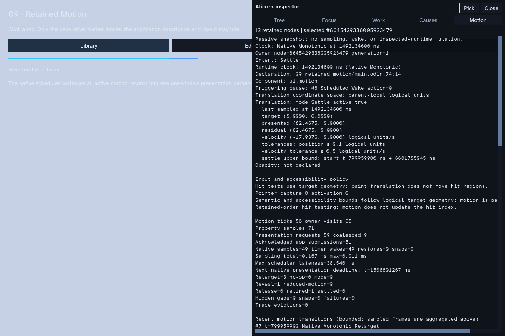
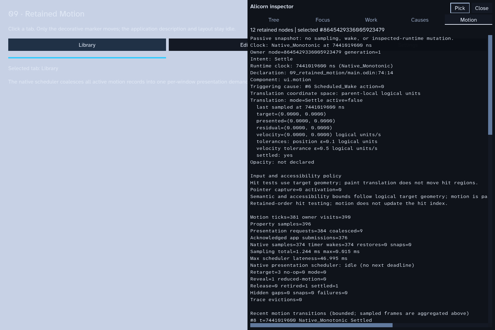

# Issue #144 — Causal motion inspector and virtual-clock replay

Status: gap-closing implementation and Windows native evidence recorded. Issue
#144 remains open for any broader release-gate or platform acceptance work.

## Result

The existing Motion inspector, bounded transition ring, and virtual-clock
replay were completed rather than replaced. The inspector now presents the
causal chain in a compact, reproducible view: declaration and triggering cause,
intent and response mode, committed target, last presented pose, residual,
velocity, property tolerances, settlement bound, and the host's next native
presentation deadline. A host with no pending deadline is explicitly shown as
idle. Selecting the Motion tab without an owner selects the first retained
motion owner, which makes native captures repeatable.

The inspector continues to read snapshots only. It does not sample a motion,
advance the inspected runtime clock, mutate its diagnostic history, or schedule
application work. The native host summary is copied into the inspector snapshot
and includes the scheduler's active/suspended state and next deadline.

## Reproducible replay

`runtime/motion_replay_test.odin` now runs the same logical timeline under two
different sampling schedules and compares the state at matching event times.
The transition trace and motion results are deterministic even though aggregate
sample counts differ.

| Virtual time | Event | Expected observable state |
| --- | --- | --- |
| 0 ms | Declare target A, cause 701 | A's intent, source, cause, target, and initial presentation are recorded |
| 100 ms | Interrupt with target B, cause 702 | Position and residual velocity continue from the sampled A response |
| 145 ms | Declare B again | One unchanged-target no-op; no response restart |
| 160 ms | Interrupt with target C, cause 703 | C becomes the target while presentation and velocity remain continuous |
| 220 ms | Start a second decorative response | The primary A→B→C response remains independently active |
| 250 ms | Enable reduced motion and redeclare the second target | The preference rewrite snaps that response to its target and records the cause |
| 280 ms | Suspend the host | The primary response is still active; its last presented pose and sample time are retained |
| 900 ms | Inspect while hidden, then restore and tick once | Hidden inspection leaves pose, velocity, and sample timestamp unchanged; restore evaluates current time once and records the hidden gap |
| After restore | Allow the primary response to settle, then retire its owner | Exact target/zero velocity and settlement are visible before node retirement removes the owner |

Sparse and irregular runs compare cause, source, intent, target, presented
position, residual velocity, response configuration, and mode at A/B/C and
restore checkpoints. Both include two genuine retargets, one no-op, a reduced
motion rewrite, an active suspension, a hidden-gap fast-forward, settlement,
and owner retirement. The diagnostic ring contains transitions, not a record
for every frame.

The hidden segment is a deterministic runtime replay. It verifies suspension
and current-time resume semantics; it is not a physical minimize/restore test.
Native window lifecycle acceptance is tracked separately under #146.

## Native inspector screenshots

Captured with Example 09 at 1440×960 on Windows 10 Home build 19045, Direct3D12,
SDL 3.4.2, and Odin `dev-2026-09-nightly:a2fb372`.

### Interrupted motion

The selected owner shows its declaration and cause, current target and last
presented pose, residual velocity, tolerances, settlement bound, recent causal
transitions, and the upcoming native presentation deadline.



### Settled and idle

After the response settles, the target and presented value agree, velocity is
zero, the owner reports settled, and the native scheduler has no next deadline.



Reproduction commands are in the [native diagnostics section of the developer guide](../development.md#motion-inspector-and-virtual-clock-replay).

## Passive inspection and idle evidence

Runtime inspector regressions compare the inspected application's state,
description/reconciliation/measurement/layout work counters, allocation
counters, motion activity and clock, diagnostic stats/history, and pending
presentation state before and after building the Motion tab. The values remain
unchanged. Native-host tests also confirm that an enabled but closed inspector
has no pending inspector submission.

The failure-path audit found existing coverage in
`runtime/motion_retained_test.odin::test_motion_diagnostics_report_invalid_ids_and_owner_cap`:
an invalid retained node ID produces a `.Failure` event with
`.Owner_Not_Retained`, and reaching the owner cap produces a `.Failure` event
with `.Owner_Limit`; both increment the aggregate failure counter. This case
passed in the full Windows run below, so no additional failure-path test was
needed.

A paired Windows D3D12 idle run compared Example 09 with no inspector allocation
against the same executable with the inspector allocated but hidden. Each run
used a three-second idle-validation interval and `--diagnostics`:

| Measurement | No inspector | Inspector allocated, hidden |
| --- | ---: | ---: |
| Validation result | PASS | PASS |
| Wall interval | 3.1187 s | 3.1484 s |
| Total / primary GPU submissions | 1 / 1 | 1 / 1 |
| Motion samples / timer wakes | 0 / 0 | 0 / 0 |
| Application / native-host wake events | 0 / 0 | 0 / 0 |
| Event waits / timeout returns | 1 / 1 | 1 / 1 |
| Inspector encodes / submissions | 0 / 0 | 0 / 0 |

This is one paired observation, not a latency distribution. Its wall-time
difference is process and environment noise; the useful result is that hiding
the inspector added no observed wake, event wait, GPU submission, or inspector
submission. Existing multi-process sampling measurements are recorded in the
[#146 progress report](issue-146-progress-2026-10-30.md): closed-visual-inspector
motion sampling p95 changed by 0% at one owner, −0.6% at 100 owners, and +2.2%
at 1,000 owners, with zero per-tick sampling allocations on both revisions.
Those measurements cover the diagnostics path while the visual inspector is
not constructed, and should not be conflated with the paired hidden-inspector
idle run above.

## Verification

The complete Windows test script passed on the implementation revision:

- Runtime: 303 tests
- UI: 39 tests
- Themes: 35 tests
- Native SDL: 168 tests
- AccessKit ABI: 8 tests
- Scroll capture: 6 tests
- Foundation and accessibility smoke checks: passed

Command:

```powershell
.\tools\test.ps1 -Odin 'C:\Users\saman\Documents\odin\dist\odin.exe'
```

Native screenshot and idle observations used the same Windows/Direct3D12 host.
This report does not claim new macOS or Linux physical validation.
