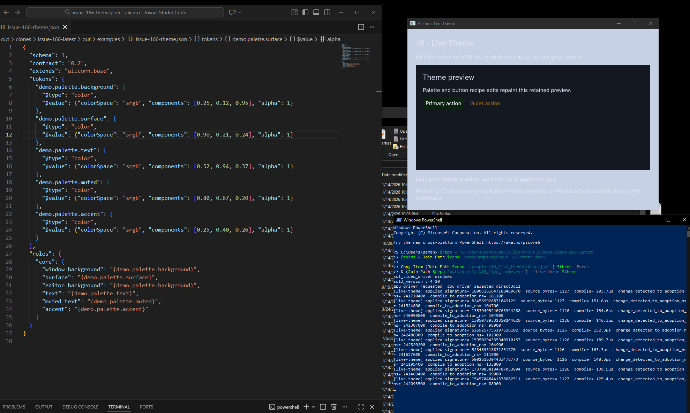
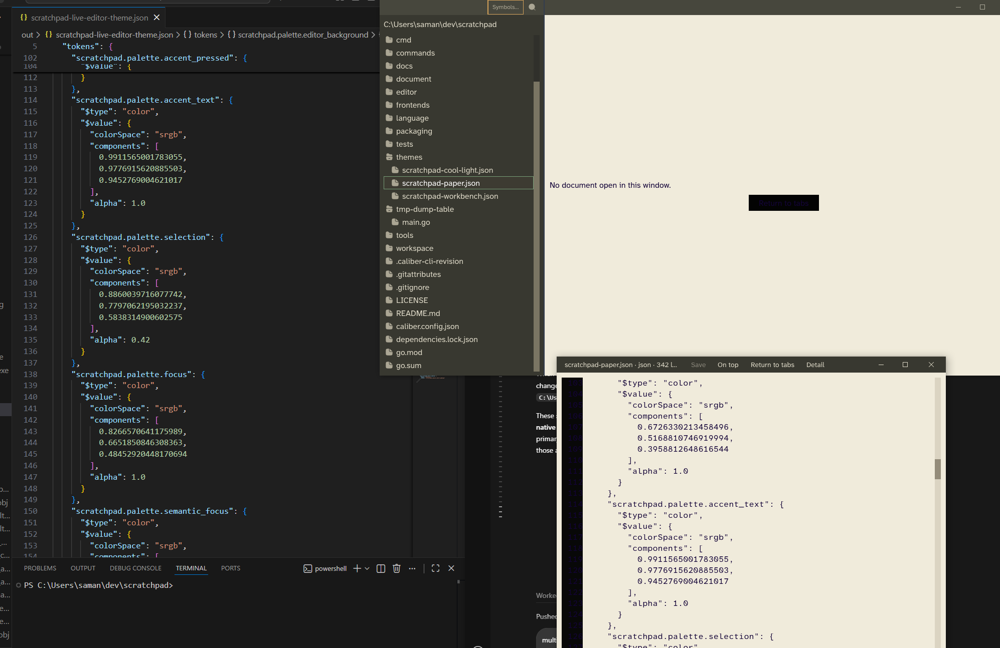

# Issue #166 — live theme editing Windows prototype

Validated on Windows on 2026-11-08 in a native SDL3/D3D12 process with the
project-pinned Odin `dev-2026-11-nightly:9a69916`. SDL reported version 3.4.2.
The machine's WMI CPU/GPU details were unavailable to this process, so they
are not recorded.

## Prototype

`examples/10_live_theme` is an opt-in development example. The ordinary
runtime does not start a file watcher. When launched with `--live-theme`, a
worker polls file metadata every 80 ms, waits for a 240 ms quiet period,
compiles through the existing strict theme compiler, validates that the file
did not change during compilation, and publishes one owned candidate to the
UI thread. A 1 MiB source limit is enforced before reading. Invalid candidates
show a source-located diagnostic and leave the last-good runtime theme intact.

Runtime replacement keeps the theme ID stable and stages owned storage before
releasing the previous snapshot. Paint-only changes request presentation
without rebuilding the application description; metric and motion-policy
changes invalidate the root because application-authored layout and motion
requests may depend on them. Identical runtime values are a no-op. Material
definitions are validated by the compiler but are not applied by this first
slice because the runtime has no stable named-material replacement registry.

## Windows native smoke

The example was built and launched with its SDL3 runtime DLL. The process
created an SDL window and selected the D3D12 GPU backend. The following file
sequence was exercised against the running process:

1. A valid initial theme was adopted.
2. A valid accent-color edit was adopted while the process remained open.
3. Invalid JSON was rejected with a source location; the last-good theme
   remained installed.
4. A subsequent valid edit was adopted, proving recovery.
5. Two saves 35 ms apart produced one adoption of the final persisted file,
   consistent with the debounce/coalescing policy.

The first smoke's accepted-candidate logs measured compile times of about
0.13–0.24 ms, compile-to-UI-adoption delays of about 0.08–0.11 ms, and
change-detection-to-adoption delays of about 242–243 ms. The latter includes
the configured 240 ms debounce.

## Follow-up interactive edit session

The maintainer then edited the watched JSON theme repeatedly in Visual Studio
Code while the native preview remained open. The preview visibly adopted the
changes without restarting, and the console recorded repeated successful
`[live-theme] applied` candidates. The screenshot's native diagnostics report
SDL 3.4.20 and Direct3D 12. This is qualitative confirmation of repeated
interactive saves, not a new latency measurement.

This session still used the single-window preview. It does not test a theme
edit while Scratchpad is actively typing or scrolling, nor propagation to a
secondary window.

## Native frame and restart comparison (2026-11-09 UTC)

I captured the live example through Alicorn's native D3D12 diagnostic readback,
not desktop screen capture. The initial frame shows the blue accent; after
editing the same JSON file twice, captured frames show the red and then green
accent while the process remains open. The final capture had
`presentation_revision == submitted_revision == 5` and five application GPU
submissions. The screenshots are 720×520 at 100% display scale:

- [Initial blue theme](assets/issue-166-windows-live-theme-before.png)
- [Updated green theme](assets/issue-166-windows-live-theme-after.png)

Three file-save-to-native-capture samples were 369.5, 438.6, and 417.5 ms
(median 417.5 ms). Candidate adoption itself took about 275–282 ms after the
save, including the 240 ms debounce and file-poll scheduling. The measured
compile-to-adoption delay ranged from 0.09 to 0.48 ms. The native capture
timestamp is an upper bound on when the updated frame was presented, not a
direct measurement of the first visible pixel.

For a restart baseline, I built a temporary harness that synchronously loaded
the same JSON theme once at startup, with no watcher, and automatically
captured its first submitted D3D12 frame. Three process-launch-to-first-frame
captures were 693.2, 485.5, and 583.9 ms (median 583.9 ms). The live-edit
median was 166 ms, or about 28.5%, lower. This is a useful same-machine
comparison, though not a perfectly matched benchmark: live captures were
requested with F12 after adoption, while restart captures were automatic at
the first GPU submission. Both measurements stop at Alicorn's native capture;
they are not photon-timing measurements.

The before/after diagnostics retained 12 runtime nodes and semantic revision
2. Layout visits (44), measurement visits (68), text-shape calls (12), and
text-mesh rebuilds (2) did not increase across the color-only replacement.
Paint and composition work advanced to produce the new colors. After roughly
19 seconds of watched idle, the native diagnostics showed zero application
ticks, scheduled/frequent wakes, or additional application GPU submissions
before the manual capture. The file watcher remained on its sleeping worker.

## Checks

Re-run on 2026-11-09 at `05281552` with Odin
`dev-2026-11-nightly:9a69916`:

- `tools/test.ps1 -Odin <project-pinned Odin>` — passed all configured suites,
  including AccessKit ABI/UIA, runtime, theme, UI, and native host checks.
- `tools/check.ps1 -Odin <project-pinned Odin>` — passed all configured builds
  and checks.
- `odin test runtime` — 326 tests passed, including theme replacement,
  invalid-candidate retention, stable identity, style-domain invalidation,
  interaction-state retention, and per-Runtime isolation.
- `odin test theme` — 35 tests passed.
- `odin check examples/10_live_theme` and `odin build examples/10_live_theme` —
  passed and linked; the native smoke required the SDL3 DLL beside the
  executable.
- `git diff --check` — passed.
- The compiler emitted existing large-stack warnings for the native test
  helper `Native_Secondary_Window`; no check failed.

## Scratchpad native dogfood follow-up (maintainer report, 2026-11-09)

Scratchpad `1da8f94` adds an opt-in editor-theme watcher using the same Alicorn
theme compiler. The maintainer reports that native Scratchpad validation
covered live reload across multiple windows and continued text scrolling while
working in the editor. The user reports the Scratchpad validation is complete;
no Scratchpad-specific latency measurements were supplied. The screenshot was
provided with that validation report.

The Scratchpad build succeeded on Windows with Alicorn `ae43c830` and Odin
`dev-2026-11-nightly:08539cd`. Its watcher is started only when
`SCRATCHPAD_LIVE_EDITOR_THEME_PATH` is explicitly set; ordinary launches do not
start a watcher. Invalid candidates retain the last-good theme. This consumer
dogfood closes the native multi-window and editor-scrolling checks for the
opt-in development workflow. It does not add live theme watching to Alicorn's
release runtime.

## Assessment and remaining limits

The Windows native D3D12 example established visible replacement, last-good
recovery, rapid-save handling, low edit-to-visible latency, and zero idle
application work. Scratchpad's native dogfood adds maintainer-reported
multi-window propagation and continued scrolling during editor use. Together,
these meet the GO criteria for the opt-in theme-editing development workflow.

Physical macOS live-edit behavior was not tested in this validation session,
and no separate Scratchpad timing sample was recorded. The watcher remains an
explicit development opt-in; this issue does not add a watcher to Alicorn's
release runtime or promise a production theme-reload feature.
